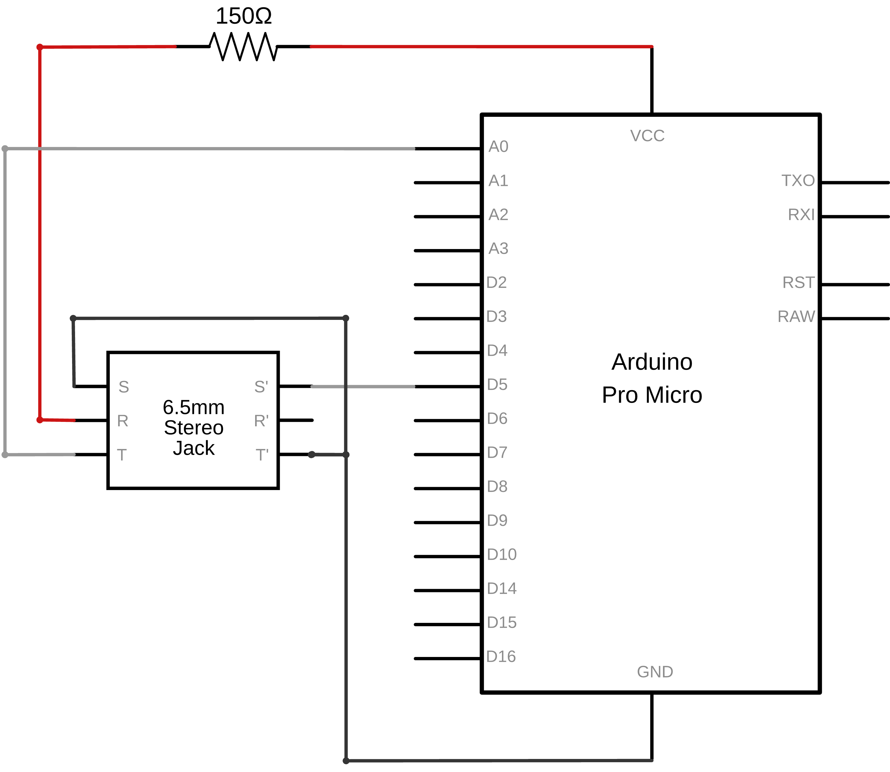
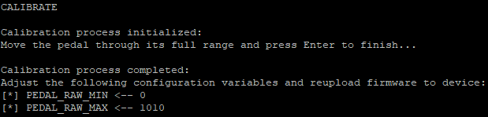

# MIDI-XP 📈


## Table of Contents

- [Description](#description)
    - [Project](#project)
    - [Repository](#repository)
    - [Technical Details](#technical-details)
- [Gallery](#gallery)
    - [Circuit Diagram](#circuit-diagram)
    - [Hardware Assembly](#hardware-assembly)
- [Usage](#usage)
    - [Configuration](#configuration)
    - [Calibration](#calibration)
    - [Debugging](#debugging)
- [License](#license)


## Description

### Project
**MIDI-XP** serves as a compact interface for connecting an expression pedal to a computer and sending MIDI Control Change (CC) messages over low-latency USB communication. The device is Class Compliant, thus it is instantly recognized by compatible operating systems and music software, without the need of additional drivers.

### Repository
The code in this repository is organized into two directories, namely [*src*](src) and [*include*](include), which contain the source (`.cpp`) and header (`.h`) files of the project, respectively. Moreover, the [*img*](img) directory contains all images displayed in the present documentation.

### Technical Details
This project was developed using *Visual Studio Code* on `Windows 10`, with the *PlatformIO* extension employed to upload the code to the *ATmega32U4* microcontroller embedded in an *Arduino*-compatible *Pro Micro* board. Moreover, the circuit includes a single 6-pin TRS input jack for the expression pedal, along with a 150Ω resistor to prevent shorting the power rails during hot-plugging.


## Gallery

### Circuit Diagram


### Hardware Assembly
")
")


## Usage

### Configuration

To customize the device for your needs, you may need to adjust some of the variables defined in the [`Configuration.h`](include/Configuration.h) file. For example, to set the desired MIDI channel and CC number of the transmitted messages, simply modify the following variables:

```cpp
constexpr uint8_t MIDI_CHANNEL = 1;
constexpr uint8_t MIDI_CC = 4;
```

### Calibration

To ensure proper behavior of the device, you will need to calibrate it while your expression pedal is connected. To do this, first open a serial monitor, such as the ones provided by the *Arduino IDE* or the *PlatformIO* extension. Then, type the case-insensitive command `CALIBRATE` and follow the instructions, as shown below:



### Debugging

In case you encounter any issues, or if you just wish to inspect the transmitted MIDI messages or the raw ADC readings during calibration, simply go to the [`Configuration.h`](include/Configuration.h) file and change the `DEBUG` macro definition from `0` to `1`, like this:

```cpp
#define DEBUG 1
```

## License

*MIDI-XP* © *2026* by *Alexandros Iliadis* is licensed under the [MIT License](https://choosealicense.com/licenses/mit/).

A short and simple permissive license with conditions only requiring preservation of copyright and license notices. Licensed works, modifications, and larger works may be distributed under different terms and without source code.

See the [`LICENSE.md`](LICENSE.md) file for more details.